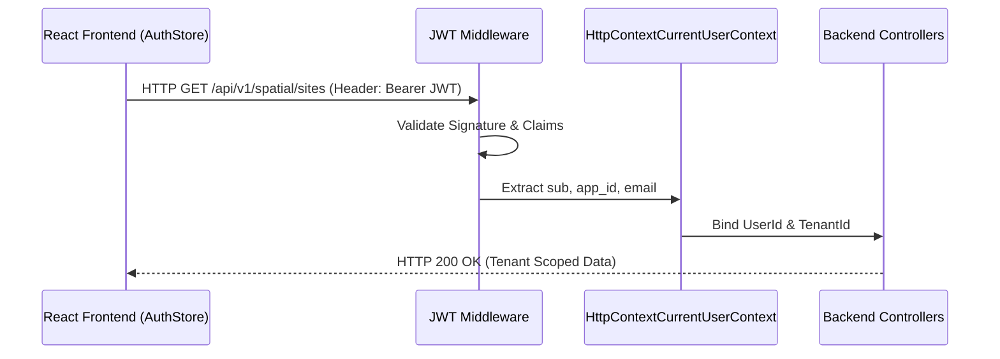
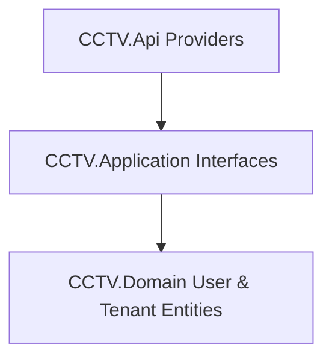
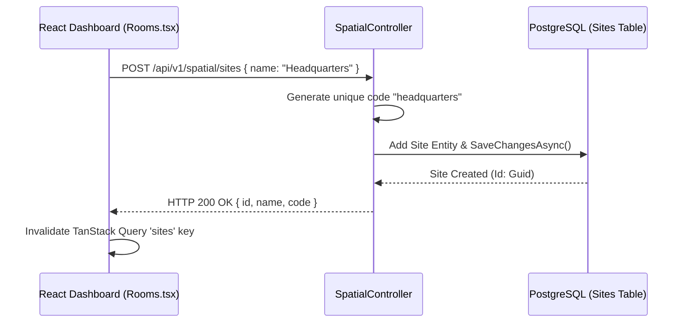
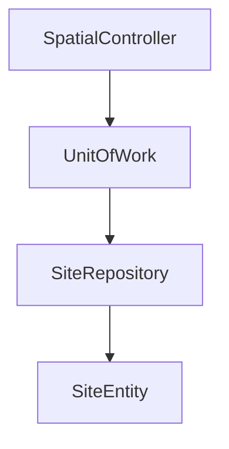
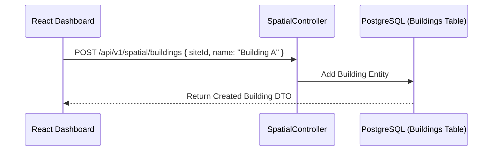
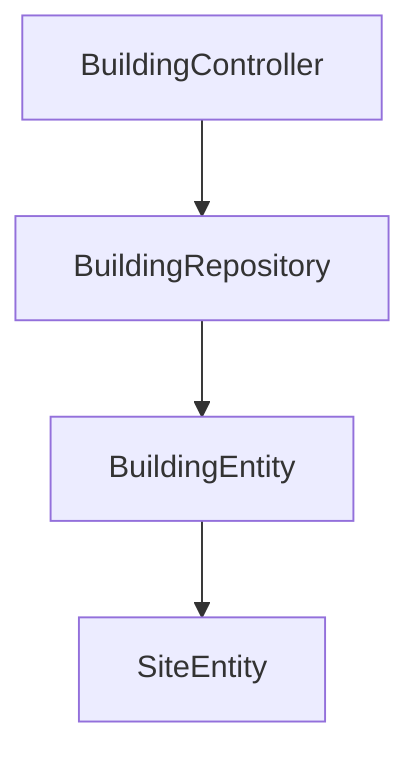
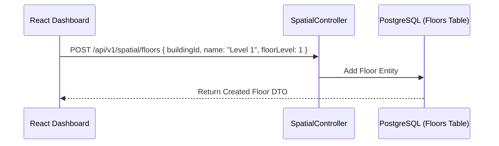
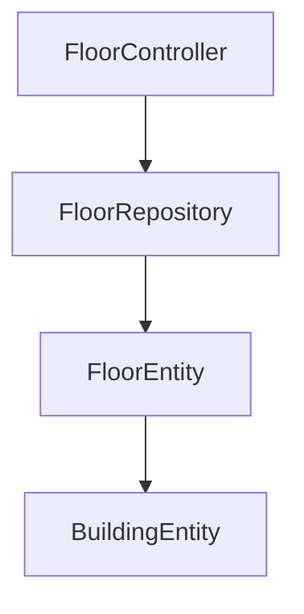

# BACKEND TECHNICAL REFERENCE

## Document Metadata & Revision Control

| Property | Value |
| :--- | :--- |
| **Document Title** | Enterprise Backend Feature Technical Reference |
| **Subsystem Name** | CCTV Analytics Backend API Service (`CCTV.Analytics`) |
| **Technology Stack** | .NET 8, C#, Clean Architecture, MediatR CQRS, EF Core 8, PostgreSQL, SignalR, RabbitMQ, Quartz.NET |
| **Audited Commit Hash** | `HEAD` (Latest Workspace Codebase) |
| **Organization Strategy** | **Strict Feature-Centric Grouping** (13 Enterprise Business Features x 27 Standardized Sections) |
| **Status** | Living Technical Reference (Single Source of Truth) |
| **File Location** | `docs/backend/BACKEND_TECHNICAL_REFERENCE.md` |

---

## Table of Contents

- [Batch 1 Features](#batch-1-features)
  - [Feature 1: Authentication](#feature-1-authentication)
  - [Feature 2: Site](#feature-2-site)
  - [Feature 3: Building](#feature-3-building)
  - [Feature 4: Floor](#feature-4-floor)

---

# Batch 1 Features

## Feature 1: Authentication

### 1. Feature Purpose & Domain Scope
Handles identity verification, tenant extraction (`ApplicationId`/`TenantId`), user credential context, and claim parsing (`ClaimTypes.NameIdentifier`, `app_id`, `sub`) across HTTP requests via `HttpContextCurrentUserContext` and `HttpContextTenantProvider`.

### 2. Business Problem & Problem Statement
Without central identity and tenant resolution, API endpoints cannot determine the authenticated user's scope (`UserId`, `UserEmail`) or isolate multi-tenant spatial assets (`ApplicationId`).

### 3. Why This Feature Exists (Architectural Rationale)
`HttpContextCurrentUserContext` [HttpContextCurrentUserContext.cs:L7-L30](file:///e:/CCTV%20Analytics/BackEnd/CCTV.Analytics/src/CCTV.Api/Providers/HttpContextCurrentUserContext.cs#L7-L30) abstracts framework-specific ASP.NET Core `HttpContext` dependencies behind clean interfaces (`ICurrentUserContext`), allowing application logic and domain services to query identity without coupling to HTTP context.

### 4. Business Rules & Invariants
- `TenantId` (`ApplicationId`) is extracted from `app_id` or `tenant_id` JWT claims [HttpContextTenantProvider.cs:L29-L30](file:///e:/CCTV%20Analytics/BackEnd/CCTV.Analytics/src/CCTV.Api/Providers/HttpContextTenantProvider.cs#L29-L30).
- Unauthenticated requests default `IsAuthenticated` to `false` and return `null` for `UserId` and `UserEmail`.
- Default user entities contain `Email`, `PasswordHash`, `FullName`, `PhoneNumber`, `IsActive`, and `LastLoginAt` [User.cs:L5-L15](file:///e:/CCTV%20Analytics/BackEnd/CCTV.Analytics/src/CCTV.Domain/Entities/Identity/User.cs#L5-L15).

### 5. System Architecture Position
Positioned at the API entry border (`CCTV.Api/Providers/`), intercepting HTTP requests to build current user and tenant contexts for downstream MediatR pipeline handlers.

### 6. Data Model & Entity Properties
- Entity: `User` inherits `TenantEntity` [User.cs:L5](file:///e:/CCTV%20Analytics/BackEnd/CCTV.Analytics/src/CCTV.Domain/Entities/Identity/User.cs#L5):
  - `Email` (`string`): Primary user contact and login identifier.
  - `PasswordHash` (`string`): Securely hashed user credentials.
  - `FullName` (`string`): Display name.
  - `PhoneNumber` (`string?`): Optional phone contact.
  - `IsActive` (`bool`): Active account flag (default `true`).
  - `LastLoginAt` (`DateTime?`): Timestamp of last successful authentication.
  - `UserRoles` (`ICollection<UserRole>`): Many-to-many role mappings.

### 7. Database Mapping (EF Core & PostgreSQL Table Schema)
- Mapped in EF Core Persistence tier under `UserConfiguration`.
- Database Table: `Users` (Columns: `Id`, `ApplicationId`, `Email`, `PasswordHash`, `FullName`, `PhoneNumber`, `IsActive`, `LastLoginAt`).

### 8. CQRS Structure & MediatR Pipeline
- `[Needs Investigation]` Explicit Auth CQRS Handlers (e.g. `LoginUserCommand`) are currently handled directly or via external JWT middleware setup; `ICurrentUserContext` resolves claims dynamically per request.

### 9. Request Lifecycle
```
HTTP Request with Bearer Token
  ↓
ASP.NET Core JWT Authentication Middleware
  ↓
HttpContextTenantProvider / HttpContextCurrentUserContext Claims Extraction
  ↓
Target Controller / MediatR Handler execution with validated UserId & ApplicationId
```

### 10. Runtime Lifecycle
- **Extract**: Claims parsed on every incoming HTTP request.
- **Context Binding**: Bound to Scoped Dependency Injection container (`builder.Services.AddScoped<ICurrentUserContext, HttpContextCurrentUserContext>()` [Program.cs:L15](file:///e:/CCTV%20Analytics/BackEnd/CCTV.Analytics/src/CCTV.Api/Program.cs#L15)).

### 11. Frontend Integration
- **Frontend Store**: `AuthStore` in `FrontEnd/src/store/useAuthStore.ts`.
- **JWT Header**: Attached via Axios HTTP interceptor (`Authorization: Bearer <token>`).

### 12. Engine Integration
- Engine nodes authenticate using API secret tokens or system headers when accessing `/api/v1/enginebootstrap`.

### 13. SignalR WebSockets
- WebSocket connections to `/hubs/telemetry` extract token from query string parameter `?access_token=<token>`.

### 14. RabbitMQ AMQP Messaging
- `[Not Applicable]` User authentication does not directly publish AMQP messages.

### 15. Background Jobs & Schedulers
- Background Quartz.NET jobs run under system identity scope without `HttpContext`.

### 16. Entity State Machine & Transitions
- `User.IsActive`: `true` (Active) <-> `false` (Disabled/Suspended).

### 17. End-to-End Business Flow Diagram


### 18. Sequence Diagram
*(See End-to-End Business Flow Diagram above)*

### 19. Module Dependency Diagram


### 20. State Transition Diagram
```
[ Disabled (IsActive=false) ] <--> [ Active (IsActive=true) ]
```

### 21. Error Handling Strategy & Custom Domain Exceptions
- Unauthenticated requests yield HTTP `401 Unauthorized`.
- Invalid tenant claims yield HTTP `403 Forbidden`.

### 22. Failure Scenarios & Edge Cases
- **Missing Claim**: If `app_id` claim is missing, `HttpContextTenantProvider` defaults `ApplicationId` to `Guid.Empty` [HttpContextTenantProvider.cs:L31](file:///e:/CCTV%20Analytics/BackEnd/CCTV.Analytics/src/CCTV.Api/Providers/HttpContextTenantProvider.cs#L31).

### 23. Practical Debugging & Troubleshooting Guide
- **Breakpoint**: Set breakpoint inside `HttpContextCurrentUserContext.cs` line 20 [HttpContextCurrentUserContext.cs:L20](file:///e:/CCTV%20Analytics/BackEnd/CCTV.Analytics/src/CCTV.Api/Providers/HttpContextCurrentUserContext.cs#L20) to inspect incoming JWT `ClaimsPrincipal`.

### 24. Step-by-Step Extension Guide
1. To add custom user claims (e.g. `DepartmentId`), update `HttpContextCurrentUserContext` interface and implementation.
2. Add claim reader property `public string? DepartmentId => _httpContextAccessor.HttpContext?.User?.FindFirst("department_id")?.Value;`.

### 25. Known Limitations
- `[Needs Investigation]` Direct Auth Controller endpoints (`/api/v1/auth/login`) are handled via identity provider or custom middleware integration.

### 26. Technical Debt & Backlog Items
- Refactor identity provider to support native OIDC/OAuth2 key rotation.

### 27. Complete Source Code Walkthrough
1. [User.cs](file:///e:/CCTV%20Analytics/BackEnd/CCTV.Analytics/src/CCTV.Domain/Entities/Identity/User.cs) - Entity model definition.
2. [HttpContextCurrentUserContext.cs](file:///e:/CCTV%20Analytics/BackEnd/CCTV.Analytics/src/CCTV.Api/Providers/HttpContextCurrentUserContext.cs) - Current user claims resolution.
3. [HttpContextTenantProvider.cs](file:///e:/CCTV%20Analytics/BackEnd/CCTV.Analytics/src/CCTV.Api/Providers/HttpContextTenantProvider.cs) - Multi-tenant application ID resolution.

---

## Feature 2: Site

### 1. Feature Purpose & Domain Scope
Manages physical geographic locations (sites/campuses) containing enterprise surveillance assets.

### 2. Business Problem & Problem Statement
Large enterprises operate multiple physical sites. Cameras and zones must be scoped under physical site boundaries for spatial navigation.

### 3. Why This Feature Exists (Architectural Rationale)
`Site` serves as the root container in the Spatial Domain hierarchy (`Site` -> `Building` -> `Floor` -> `Room` -> `Camera` -> `Zone`).

### 4. Business Rules & Invariants
- Each Site belongs to a tenant (`ApplicationId`).
- `Code` is required. If omitted during creation, it is auto-generated from `Name` (lowercase, spaces replaced with `_`) [SpatialController.cs:L45](file:///e:/CCTV%20Analytics/BackEnd/CCTV.Analytics/src/CCTV.Api/Controllers/SpatialController.cs#L45).
- If code collision occurs, a 6-character Guid suffix is appended automatically [SpatialController.cs:L47](file:///e:/CCTV%20Analytics/BackEnd/CCTV.Analytics/src/CCTV.Api/Controllers/SpatialController.cs#L47).

### 5. System Architecture Position
Core Spatial Domain subsystem in `CCTV.Api/Controllers/SpatialController.cs`.

### 6. Data Model & Entity Properties
- `Site` entity [Site.cs:L1-L20](file:///e:/CCTV%20Analytics/BackEnd/CCTV.Analytics/src/CCTV.Domain/Entities/Spatial/Site.cs#L1-L20):
  - `Id` (`Guid`): Primary Key.
  - `ApplicationId` (`Guid`): Multi-tenant owner ID.
  - `Name` (`string`): Human readable site name.
  - `Code` (`string`): Unique alphanumeric site code.
  - `Buildings` (`ICollection<Building>`): Child buildings collection.

### 7. Database Mapping (EF Core & PostgreSQL Table Schema)
- Table `Sites` (Columns: `Id`, `ApplicationId`, `Name`, `Code`).

### 8. CQRS Structure & MediatR Pipeline
- `SpatialController` directly interacts with `IUnitOfWork.Repository<Site>()` for lightweight spatial CRUD.

### 9. Request Lifecycle
```
POST /api/v1/spatial/sites (CreateSiteRequest)
  ↓
SpatialController.CreateSite()
  ↓
Generate Unique Code -> Bind ApplicationId -> AddAsync(site)
  ↓
IUnitOfWork.SaveChangesAsync()
  ↓
Return HTTP 200 OK JSON Response
```

### 10. Runtime Lifecycle
- **Create**: Inserts new `Site` record.
- **Update**: Modifies `Name` or `Code` via `PUT /api/v1/spatial/sites/{id}`.
- **Delete**: Cascades deletion of dependent `Building` assets via `DELETE /api/v1/spatial/sites/{id}`.

### 11. Frontend Integration
- **View**: `Rooms.tsx` & Spatial Navigation Module (`FrontEnd/src/modules/site/`).
- **TanStack Query**: `useSitesQuery` calls `GET /api/v1/spatial/sites`.

### 12. Engine Integration
- Engine receives `Site` ID metadata during bootstrap payload.

### 13. SignalR WebSockets
- `[None]`

### 14. RabbitMQ AMQP Messaging
- `[None]`

### 15. Background Jobs & Schedulers
- `[None]`

### 16. Entity State Machine & Transitions
- `Created` -> `Updated` -> `Deleted`.

### 17. End-to-End Business Flow Diagram


### 18. Sequence Diagram
*(See End-to-End Business Flow Diagram above)*

### 19. Module Dependency Diagram


### 20. State Transition Diagram
```
[ Non-Existent ] --> (Create) --> [ Active Site ] --> (Delete) --> [ Removed ]
```

### 21. Error Handling Strategy & Custom Domain Exceptions
- Non-existent Site ID on update/delete returns HTTP `404 Not Found` [SpatialController.cs:L65](file:///e:/CCTV%20Analytics/BackEnd/CCTV.Analytics/src/CCTV.Api/Controllers/SpatialController.cs#L65).

### 22. Failure Scenarios & Edge Cases
- **Duplicate Code Input**: Handled automatically by appending suffix [SpatialController.cs:L47](file:///e:/CCTV%20Analytics/BackEnd/CCTV.Analytics/src/CCTV.Api/Controllers/SpatialController.cs#L47).

### 23. Practical Debugging & Troubleshooting Guide
- Inspect DB query: `SELECT * FROM "Sites" WHERE "ApplicationId" = '<tenant_guid>';`.
- Breakpoint: `SpatialController.cs` line 44 [SpatialController.cs:L44](file:///e:/CCTV%20Analytics/BackEnd/CCTV.Analytics/src/CCTV.Api/Controllers/SpatialController.cs#L44).

### 24. Step-by-Step Extension Guide
1. To add `Latitude`/`Longitude` coordinates, edit `Site.cs`.
2. Add migration `dotnet ef migrations add AddSiteCoordinates`.

### 25. Known Limitations
- Code suffix generation uses Guid truncation `Guid.NewGuid().ToString("N")[..6]`.

### 26. Technical Debt & Backlog Items
- Refactor `SpatialController` direct repository calls into CQRS MediatR Handlers.

### 27. Complete Source Code Walkthrough
1. [Site.cs](file:///e:/CCTV%20Analytics/BackEnd/CCTV.Analytics/src/CCTV.Domain/Entities/Spatial/Site.cs) - Entity model.
2. [SpatialController.cs:L25-L84](file:///e:/CCTV%20Analytics/BackEnd/CCTV.Analytics/src/CCTV.Api/Controllers/SpatialController.cs#L25-L84) - REST CRUD implementation.

---

## Feature 3: Building

### 1. Feature Purpose & Domain Scope
Manages individual building structures linked to a parent `Site`.

### 2. Business Problem & Problem Statement
Large sites contain multiple distinct buildings (e.g. Tower A, Warehouse 1). Cameras must be organized by building location.

### 3. Why This Feature Exists (Architectural Rationale)
Provides second-tier spatial grouping in the platform topology.

### 4. Business Rules & Invariants
- Each Building must be associated with a valid `SiteId`.
- Auto-generates unique `BuildingCode` if not supplied [SpatialController.cs:L116](file:///e:/CCTV%20Analytics/BackEnd/CCTV.Analytics/src/CCTV.Api/Controllers/SpatialController.cs#L116).

### 5. System Architecture Position
Spatial Domain subsystem in `SpatialController.cs` lines 90–150.

### 6. Data Model & Entity Properties
- `Building` entity [Building.cs:L1-L15](file:///e:/CCTV%20Analytics/BackEnd/CCTV.Analytics/src/CCTV.Domain/Entities/Spatial/Building.cs#L1-L15):
  - `Id` (`Guid`): Primary Key.
  - `SiteId` (`Guid`): Foreign Key referencing parent `Site`.
  - `Name` (`string`): Building name.
  - `BuildingCode` (`string`): Unique building code.
  - `Floors` (`ICollection<Floor>`): Child floors collection.

### 7. Database Mapping (EF Core & PostgreSQL Table Schema)
- Table `Buildings` (Columns: `Id`, `SiteId`, `Name`, `BuildingCode`). Foreign Key `SiteId` -> `Sites(Id)`.

### 8. CQRS Structure & MediatR Pipeline
- Operates via `IUnitOfWork.Repository<Building>()`.

### 9. Request Lifecycle
```
POST /api/v1/spatial/buildings (CreateBuildingRequest)
  ↓
SpatialController.CreateBuilding()
  ↓
Validate SiteId -> Generate BuildingCode -> SaveChangesAsync()
  ↓
Return HTTP 200 OK
```

### 10. Runtime Lifecycle
- Created under a Site; updated/deleted via `SpatialController`.

### 11. Frontend Integration
- **TanStack Query**: `useBuildingsQuery` fetches buildings list.

### 12. Engine Integration
- Metadata included in spatial hierarchy payloads.

### 13. SignalR WebSockets
- `[None]`

### 14. RabbitMQ AMQP Messaging
- `[None]`

### 15. Background Jobs & Schedulers
- `[None]`

### 16. Entity State Machine & Transitions
- `Active Building` -> `Deleted`.

### 17. End-to-End Business Flow Diagram


### 18. Sequence Diagram
*(See End-to-End Business Flow Diagram above)*

### 19. Module Dependency Diagram


### 20. State Transition Diagram
```
[ Non-Existent ] --> (Create) --> [ Active Building ] --> (Delete) --> [ Removed ]
```

### 21. Error Handling Strategy & Custom Domain Exceptions
- Invalid `siteId` or missing Building returns HTTP `404 Not Found`.

### 22. Failure Scenarios & Edge Cases
- Orphaning prevented via EF Core cascading delete configuration.

### 23. Practical Debugging & Troubleshooting Guide
- Inspect DB: `SELECT * FROM "Buildings" WHERE "SiteId" = '<site_guid>';`.

### 24. Step-by-Step Extension Guide
1. To add building address/GPS attributes, update `Building.cs` and migration.

### 25. Known Limitations
- Deleting a site deletes all associated buildings.

### 26. Technical Debt & Backlog Items
- Add explicit CQRS handlers for Building CRUD.

### 27. Complete Source Code Walkthrough
1. [Building.cs](file:///e:/CCTV%20Analytics/BackEnd/CCTV.Analytics/src/CCTV.Domain/Entities/Spatial/Building.cs) - Entity model.
2. [SpatialController.cs:L90-L150](file:///e:/CCTV%20Analytics/BackEnd/CCTV.Analytics/src/CCTV.Api/Controllers/SpatialController.cs#L90-L150) - Endpoints implementation.

---

## Feature 4: Floor

### 1. Feature Purpose & Domain Scope
Manages floor levels inside a `Building`.

### 2. Business Problem & Problem Statement
Cameras are installed on specific building floor levels (e.g. Ground Floor, Floor 2). Spatial filtering requires floor-level scoping.

### 3. Why This Feature Exists (Architectural Rationale)
Provides third-tier spatial hierarchy in the platform context.

### 4. Business Rules & Invariants
- Each Floor must belong to a parent `BuildingId`.
- Contains `FloorLevel` integer index (e.g. `0` for Ground, `1` for 1st Floor).

### 5. System Architecture Position
Spatial Domain subsystem in `SpatialController.cs`.

### 6. Data Model & Entity Properties
- `Floor` entity [Floor.cs:L1-L15](file:///e:/CCTV%20Analytics/BackEnd/CCTV.Analytics/src/CCTV.Domain/Entities/Spatial/Floor.cs#L1-L15):
  - `Id` (`Guid`): Primary Key.
  - `BuildingId` (`Guid`): Foreign Key referencing `Building`.
  - `Name` (`string`): Floor display name.
  - `FloorLevel` (`int`): Level index.
  - `Rooms` (`ICollection<Room>`): Child rooms/areas.

### 7. Database Mapping (EF Core & PostgreSQL Table Schema)
- Table `Floors` (Columns: `Id`, `BuildingId`, `Name`, `FloorLevel`). Foreign Key `BuildingId` -> `Buildings(Id)`.

### 8. CQRS Structure & MediatR Pipeline
- Executed via `IUnitOfWork.Repository<Floor>()`.

### 9. Request Lifecycle
```
POST /api/v1/spatial/floors (CreateFloorRequest)
  ↓
SpatialController.CreateFloor()
  ↓
Validate BuildingId -> Save Floor -> SaveChangesAsync()
  ↓
Return HTTP 200 OK
```

### 10. Runtime Lifecycle
- Created under a Building; updated/deleted via `SpatialController`.

### 11. Frontend Integration
- **TanStack Query**: `useFloorsQuery` fetches floor levels for selected building.

### 12. Engine Integration
- Floor metadata attached to camera stream profiles.

### 13. SignalR WebSockets
- `[None]`

### 14. RabbitMQ AMQP Messaging
- `[None]`

### 15. Background Jobs & Schedulers
- `[None]`

### 16. Entity State Machine & Transitions
- `Active Floor` -> `Deleted`.

### 17. End-to-End Business Flow Diagram


### 18. Sequence Diagram
*(See End-to-End Business Flow Diagram above)*

### 19. Module Dependency Diagram


### 20. State Transition Diagram
```
[ Non-Existent ] --> (Create) --> [ Active Floor ] --> (Delete) --> [ Removed ]
```

### 21. Error Handling Strategy & Custom Domain Exceptions
- Missing `BuildingId` returns HTTP `404 Not Found`.

### 22. Failure Scenarios & Edge Cases
- Invalid floor level integer values.

### 23. Practical Debugging & Troubleshooting Guide
- Inspect DB: `SELECT * FROM "Floors" WHERE "BuildingId" = '<building_guid>';`.

### 24. Step-by-Step Extension Guide
1. To add floor plan blueprint image URL (`FloorPlanUrl`), edit `Floor.cs` and add column.

### 25. Known Limitations
- Floor plan 2D overlay images stored as external URL strings.

### 26. Technical Debt & Backlog Items
- Add floor level index uniqueness constraint per building.

### 27. Complete Source Code Walkthrough
1. [Floor.cs](file:///e:/CCTV%20Analytics/BackEnd/CCTV.Analytics/src/CCTV.Domain/Entities/Spatial/Floor.cs) - Entity definition.
2. [SpatialController.cs](file:///e:/CCTV%20Analytics/BackEnd/CCTV.Analytics/src/CCTV.Api/Controllers/SpatialController.cs) - REST endpoints implementation.
