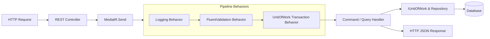
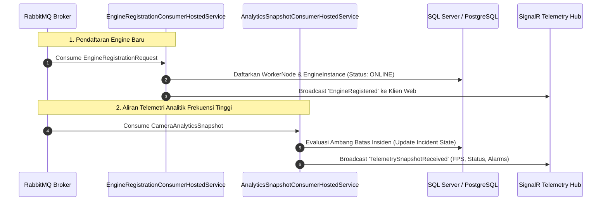

# ENTERPRISE CCTV ANALYTICS PLATFORM
## Backend Control Plane & Web API Blueprint

**Dokumen**: Backend Control Plane Architecture & Enterprise Web API Blueprint  
**Versi**: 2.0.0 Enterprise Edition  
**Tanggal**: Oktober 2026  
**Klasifikasi**: Spesifikasi Teknis Backend Control Plane & CQRS  
**Status**: Approved Living Architecture  
**Lokasi Berkas**: `docs/BLUEPRINT_BACKEND_API.md`  

---

## 1. Executive Summary & Lingkup Domain Backend

Backend Control Plane (`BackEnd/CCTV.Analytics`) adalah tulang punggung operasional platform CCTV Analytics Enterprise yang dibangun menggunakan **.NET 8** dan pola arsitektur **Clean Architecture (Onion/Hexagonal)** serta **Domain-Driven Design (DDD)**. 

### Tanggung Jawab Inti:
1. **Orkestrasi Logika Bisnis & CQRS**: Memisahkan alur modifikasi status (*Commands*) dari kueri pembacaan data (*Queries*) menggunakan MediatR.
2. **Pengelolaan Aset Spasial Terpusat**: Mengatur hierarki 6 tingkat (`Site` -> `Building` -> `Floor` -> `Room` -> `Camera` -> `Zone`) dengan integritas referensial basis data.
3. **Pendaftaran & Pemantauan Node AI**: Menerima pendaftaran otomatis worker engine melalui RabbitMQ, memantau metrik detak jantung (*heartbeat*), dan mendeteksi kondisi timeout node.
4. **Diseminasi Real-Time Berkecepatan Tinggi**: Mengonsumsi snapshot deteksi dari AI Engine dan memancarkannya secara instan ke dashboard web via SignalR WebSocket Hub.
5. **Persistensi Transaksional Multi-Tenant**: Mengisolasi data antar tenant (`ApplicationId`) secara otomatis pada tingkat ORM EF Core.

---

## 2. Lapisan Clean Architecture & Prinsip Desain DDD

```
               ┌────────────────────────────────────────────────────────┐
               │              CCTV.Api (REST Controllers)               │
               │   ┌────────────────────────────────────────────────┐   │
               │   │     CCTV.Infrastructure (RabbitMQ, SignalR)    │   │
               │   │   ┌────────────────────────────────────────┐   │   │
               │   │   │    CCTV.Persistence (EF Core 8 / UoW)   │   │   │
               │   │   │   ┌────────────────────────────────┐   │   │   │
               │   │   │   │   CCTV.Application (CQRS / DTO)│   │   │   │
               │   │   │   │   ┌────────────────────────┐   │   │   │   │
               │   │   │   │   │  CCTV.Domain (Entities)│   │   │   │   │
               │   │   │   │   └────────────────────────┘   │   │   │   │
               │   │   │   └────────────────────────────────┘   │   │   │
               │   │   └────────────────────────────────────────┘   │   │
               │   └────────────────────────────────────────────────┘   │
               └────────────────────────────────────────────────────────┘
```

| Proyek / Layer | Tanggung Jawab Desain | Ketergantungan Eksternal |
| :--- | :--- | :--- |
| **`CCTV.Domain`** | Entitas bisnis murni, Aggregate Roots, Value Objects, Domain Enums, dan aturan invarian. | **Nol Dependensi** (Hanya .NET Standard BCL murni). |
| **`CCTV.Contracts`** | Kontrak DTO bersama, skema payload event AMQP, dan kontrak pendaftaran engine. | Minimal (System.Text.Json). |
| **`CCTV.Application`** | CQRS Handlers (MediatR), validasi input (FluentValidation), abstraksi `IUnitOfWork`, `IRepository<T>`. | `CCTV.Domain`, `CCTV.Contracts`, MediatR. |
| **`CCTV.Persistence`** | Konfigurasi EF Core DbContext, migrasi skema basis data, implementasi Repository & Unit of Work. | `CCTV.Domain`, `CCTV.Application`, EF Core 8. |
| **`CCTV.Infrastructure`** | Klien RabbitMQ AMQP, Background Hosted Services, SignalR Telemetry Hub, Quartz Scheduler. | `CCTV.Application`, RabbitMQ.Client, SignalR. |
| **`CCTV.Api`** | REST API Controllers, middleware otentikasi JWT, penanganan exception terpusat, Swagger / OpenAPI. | Semua layer di atas (sebagai Composition Root). |

---

## 3. Agregat Model Domain & Entitas Inti

Domain backend mencakup lebih dari 25 entitas terstruktur yang dikelompokkan ke dalam kluster bisnis:

### 3.1 Kluster Infrastruktur Mesin AI (*Engine Cluster*)
* **`WorkerNode`**: Mewakili server fisik atau mesin virtual edge yang memiliki akselerator GPU.
* **`EngineInstance`**: Instance proses Python AI Engine aktif yang berjalan di atas WorkerNode. Menyimpan atribut hardware (`GpuModel`, `CudaVersion`, `MaxPipelines`).
* **`PipelineAssignment`**: Relasi penugasan pemrosesan antara kamera tertentu dengan engine instance aktif beserta profil analitik yang diaktifkan (`IntrusionEnabled`, `LoiteringEnabled`, dll).
* **`EngineHeartbeat`**: Catatan riwayat status kesehatan engine (CPU usage, GPU memory, FPS, active streams).

### 3.2 Kluster Hierarki Spasial (*Spatial Hierarchy Cluster*)
* **`Site`**: Lokasi fisik utama / kampus bisnis. Root dari struktur spasial.
* **`Building`**: Struktur gedung fisik yang terafiliasi dengan Site.
* **`Floor`**: Lantai gedung tertentu. Menyimpan `FloorLevel` dan URL denah `FloorPlanUrl`.
* **`Room`**: Ruangan / area fungsional indoor tempat analitik diterapkan.
* **`Camera`**: Aset kamera video dengan parameter RTSP, resolusi, status koneksi, dan relasi opsional `RoomId?`.
* **`Zone`**: Poligon koordinat analitik (`PolygonCoordinatesJson`) ternormalisasi $[0.0, 1.0]$.

### 3.3 Kluster Insiden & Event Analitik (*Incident & Alerting Cluster*)
* **`EventArchive`**: Penyimpanan arsip jangka panjang untuk setiap deteksi pelanggaran zona.
* **`Incident`**: Insiden keamanan yang dieskalasi dan membutuhkan tindakan konfirmasi operator (*New*, *Acknowledged*, *Resolved*, *FalsePositive*).
* **`IncidentEscalationRule`**: Aturan penentu kapan serangkaian event analitik harus memicu alarm darurat atau notifikasi push.

---

## 4. Pipeline CQRS MediatR & Pola Unit of Work

Semua operasi logika bisnis dieksekusi melalui pola **Command Query Responsibility Segregation (CQRS)** menggunakan pustaka MediatR:



### Keunggulan Pipeline:
1. **Validasi Deklaratif**: Setiap Command divalidasi oleh validator independen (`FluentValidation`) sebelum menyentuh handler.
2. **Audit Logging Otomatis**: Setiap request dicatat waktu eksekusinya dan korelasi ID-nya.
3. **Transaksi Terkelola**: Modifikasi lintas entitas otomatis dibungkus ke dalam database transaction `BeginTransactionAsync()` dan di-commit bersama saat handler selesai tanpa error.

---

## 5. Layanan Konsumen Latar Belakang (*Background Hosted Services*)

Backend menjalankan beberapa background worker berbasis `IHostedService` untuk mendengarkan pesan dari RabbitMQ tanpa memblokir thread HTTP:



### Spesifikasi Hosted Services:
* **`EngineRegistrationConsumerHostedService`**: Mendengarkan antrean `cctv.engine.registration`. Mengotomatiskan handshake engine saat node baru menyala di jaringan lokal.
* **`AnalyticsSnapshotConsumerHostedService`**: Mengonsumsi antrean `cctv.analytics.snapshots` secara konkuren (prefetch count: 50). Melakukan agregasi data metrik sebelum disiarkan ke SignalR.
* **`EngineTimeoutEvaluatorHostedService`**: Dijalankan secara periodik untuk mendeteksi engine yang berhenti mengirim heartbeat selama $> 15\text{ detik}$ dan secara otomatis mengubah statusnya menjadi `OFFLINE`.

---

## 6. Gateway Real-Time SignalR Hub (`/hubs/telemetry`)

Platform mengekspos WebSocket Hub terpusat di URL `/hubs/telemetry` untuk menyediakan komunikasi asinkron dua arah dengan browser:

### 6.1 Grup Koneksi Klien (*Connection Groups*)
* **`Global_Operations`**: Menerima seluruh status liveness engine, ringkasan armada, dan peringatan kritis platform.
* **`Camera_{cameraId}`**: Klien hanya menerima stream koordinat bounding box dan event dari kamera spesifik yang sedang dibuka di layar.
* **`Engine_{engineId}`**: Menerima telemetri hardware rinci dari simpul worker terkait.

### 6.2 Kontrak Metode SignalR
| Nama Event SignalR | Arah Aliran | Payload Data | Deskripsi |
| :--- | :--- | :--- | :--- |
| `AnalyticsEventPublished` | Server -> Client | `AnalyticsEvent` DTO | Disiarkan saat terjadi pelanggaran zona keamanan baru. |
| `EngineStatusChanged` | Server -> Client | `{ engineId, status, fps }` | Notifikasi perubahan status node (Online/Offline/Degraded). |
| `TelemetrySnapshotReceived` | Server -> Client | `CameraAnalyticsSnapshot` | Data telemetri periodik 1Hz per kamera. |
| `SubscribeToCamera` | Client -> Server | `Guid cameraId` | Mendaftarkan koneksi klien ke grup kamera tertentu. |

---

## 7. Keamanan Multi-Tenant & Penegakan Klaim JWT

Sistem mengadopsi prinsip isolasi multi-tenant yang ketat:
* **`HttpContextTenantProvider`**: Mengimplementasikan antarmuka `ITenantProvider`. Membaca klaim `app_id` atau `tenant_id` dari token otentikasi JWT Bearer.
* **Global Query Filter di EF Core**:
  ```csharp
  modelBuilder.Entity<Site>().HasQueryFilter(e => e.ApplicationId == _tenantProvider.ApplicationId);
  modelBuilder.Entity<Camera>().HasQueryFilter(e => e.ApplicationId == _tenantProvider.ApplicationId);
  modelBuilder.Entity<Zone>().HasQueryFilter(e => e.ApplicationId == _tenantProvider.ApplicationId);
  ```
  Setiap kueri `DbContext.Sites.ToListAsync()` secara otomatis menambahkan klausul SQL `WHERE ApplicationId = @CurrentTenant`, menjamin tidak ada kebocoran data antar perusahaan/tenant pada basis data bersama.

---

## 8. Inventaris Endpoint REST API Utama

| Modul Bisnis | Method & Rute API | Tanggung Jawab Operasional |
| :--- | :--- | :--- |
| **Spatial Site** | `GET /api/v1/spatial/sites` | Mengambil daftar seluruh lokasi kampus/site milik tenant. |
| **Spatial Site** | `POST /api/v1/spatial/sites` | Membuat site baru dengan kode unik otomatis. |
| **Spatial Building** | `GET /api/v1/spatial/buildings?siteId={id}` | Mengambil daftar gedung di bawah site tertentu. |
| **Spatial Floor** | `POST /api/v1/spatial/floors` | Menambahkan lantai gedung beserta nomor level dan denah. |
| **Spatial Room** | `POST /api/v1/spatial/rooms` | Mendaftarkan ruangan kerja / area analitik indoor. |
| **Spatial Camera** | `POST /api/v1/spatial/cameras` | Menambahkan kamera pengawas beserta endpoint RTSP-nya. |
| **Spatial Zone** | `POST /api/v1/spatial/zones` | Menyimpan poligon zona koordinat normalisasi $[0.0, 1.0]$. |
| **Engine Bootstrap** | `GET /api/v1/engine/runtime/bootstrap` | Endpoint krusial yang dipanggil oleh Python Engine saat inisialisasi. |
| **Engine Control** | `POST /api/v1/engine/{id}/commands` | Mengirim perintah kendali jarak jauh (restart, stop, update pipeline). |
| **Incident** | `GET /api/v1/incidents/active` | Mengambil daftar insiden keamanan aktif yang belum diselesaikan. |
